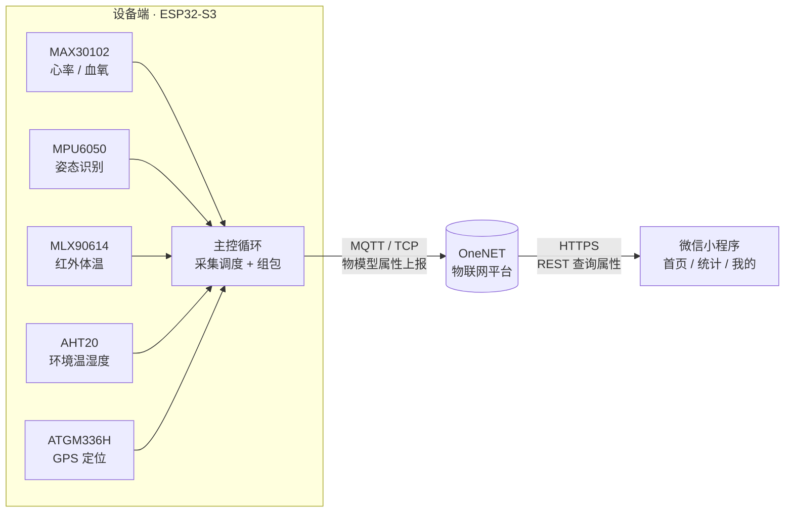
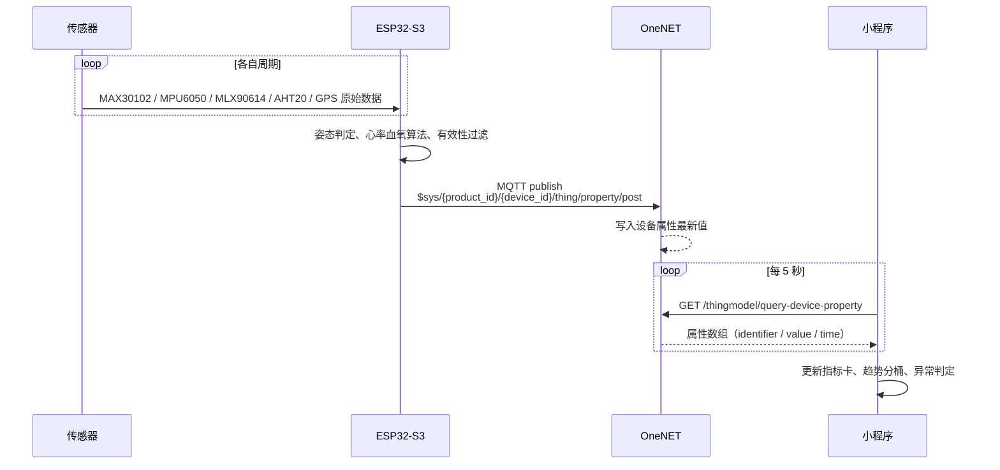

# 基于 ESP32 的宠物健康监测系统

一套从**硬件采集 → 云端中转 → 小程序展示**的完整宠物健康监测方案。设备端以 ESP32-S3 为核心，采集宠物的心率、血氧、体温、运动姿态与环境温湿度，并通过 MQTT 上报至中国移动 OneNET 物联网平台；微信小程序轮询云端数据，实时展示各项指标、姿态状态、定位信息与当日趋势曲线。

<p>
  
  
  
  
  
</p>

> 个人毕业设计项目。当前功能已闭环可用，仍有若干工程细节待完善，详见 [已知限制](#已知限制与后续计划)。

---

## 目录

- [系统架构](#系统架构)
- [功能特性](#功能特性)
- [硬件清单](#硬件清单)
- [软件结构](#软件结构)
- [数据链路](#数据链路)
- [OneNET 数据字典](#onenet-数据字典)
- [快速开始](#快速开始)
- [姿态识别算法](#姿态识别算法)
- [已知限制与后续计划](#已知限制与后续计划)
- [License](#license)

---

## 系统架构



设备端只负责采集与上报，不做业务判断；小程序只负责拉取与呈现，不做协议解析。两端通过 OneNET 的**物模型（Thing Model）**解耦，任何一端改动都不影响另一端。

## 功能特性

**设备端**

- 五类传感器统一调度，各任务按独立周期运行，互不阻塞主循环
- 心率 / 血氧基于 100 点 FIFO 缓冲，调用 Maxim 官方算法计算，仅在上报值均有效时才发送
- 基于三轴加速度与角速度的**姿态识别**（躺平 / 走动 / 跑动），带连续判定防抖
- WiFi 与 MQTT 断线自动重连，连接状态打印到串口
- 传感器初始化失败时降级运行，不阻塞其他模块

**小程序端**

- 首页：心率、血氧、体温、环境温湿度四张指标卡，按数值区间动态生成描述文案
- 姿态卡片：随上报姿态切换图标与提示语
- 地图组件：展示最新经纬度与卫星数
- 统计页：基于 ECharts 绘制心率 / 血氧 / 体温三条当日趋势曲线，5 分钟分桶聚合，越界数据自动记为异常
- 宠物档案：本地持久化，支持编辑
- 5 秒轮询云端，页面卸载时清理定时器

## 硬件清单

| 模块 | 型号 | 接口 | 地址 / 引脚 | 用途 |
|---|---|---|---|---|
| 主控 | RYMCU ESP32-S3 DevKitC-1 | — | — | 主控，启用 8MB PSRAM（QIO / 80MHz） |
| 心率血氧 | MAX30102 | I2C | `0x57` | 心率、血氧饱和度 |
| 六轴 IMU | MPU6050 | I2C | `0x68` | 加速度、角速度，用于姿态识别 |
| 红外测温 | MLX90614 | I2C | `0x5A` | 非接触式体表温度 |
| 温湿度 | AHT20 | I2C | `0x38` | 环境温度、湿度 |
| 定位 | ATGM336H | UART1 | RX `GPIO16` / TX `GPIO17`，9600 8N1 | 经纬度、卫星数 |

I2C 总线统一使用 `SDA = GPIO8`、`SCL = GPIO9`，五个 I2C 器件挂在同一总线上，地址无冲突。

## 软件结构

```
Final-Design/
├── firmware/                     # 设备端 · PlatformIO 工程
│   ├── platformio.ini            # 板卡、框架、依赖库、PSRAM 配置
│   └── src/
│       ├── main.cpp              # 初始化与主循环
│       ├── config/config.h       # 引脚、WiFi、MQTT / OneNET 凭据
│       ├── network/
│       │   ├── mywifi.cpp/.h     # WiFi 连接
│       │   └── mqtt.cpp/.h       # MQTT 连接维护与各类属性上报
│       └── sensor/
│           ├── max30102.cpp/.h   # 心率 / 血氧
│           ├── mpu6050.cpp/.h    # 六轴数据 + 姿态识别
│           ├── mlx90614.cpp/.h   # 体温
│           ├── aht20.cpp/.h      # 环境温湿度
│           └── atgm336h.cpp/.h   # GPS 解析
│
├── miniprogram/                  # 小程序端 · 微信原生框架
│   ├── app.js / app.json / app.wxss
│   ├── pages/
│   │   ├── home/                 # 首页：指标卡 + 姿态 + 定位
│   │   ├── statis/               # 统计页：ECharts 趋势曲线
│   │   ├── user/                 # 我的：宠物档案编辑
│   │   └── login/                # 登录页（模板，未接入后端）
│   ├── ec-canvas/                # ECharts 小程序适配层
│   ├── img/                      # 图标与头像
│   └── utils/
│
└── docs/
    └── 界面样式说明.txt          # 小程序各页面样式与布局说明
```

## 数据链路



上报周期一览：

| 数据 | 采集 / 上报周期 | 说明 |
|---|---|---|
| 心率、血氧 | 约 4 s | 采样率 100 Hz、4 点平均 → FIFO 输出 25 Hz，累计 100 点后计算一次 |
| 体温 | 2 s | 读取值需落在 20–50 °C 内，否则丢弃 |
| 环境温湿度 | 3 s | 读数非 NaN 才上报 |
| GPS | 3 s | 未定位时仅上报卫星数变化 |
| 姿态 | 2 s | 内部 100 ms 采样一次，连续 3 次判定一致才更新 |
| 小程序轮询 | 5 s | 页面卸载时清除定时器 |

## OneNET 数据字典

MQTT 上报的 JSON 采用物模型格式：

```json
{
  "id": "123",
  "params": {
    "Heart_rate": { "value": 98 },
    "Blood_oxygen": { "value": 97 }
  }
}
```

设备属性定义：

| identifier | 含义 | 单位 | 上报来源 |
|---|---|---|---|
| `Heart_rate` | 心率 | BPM | MAX30102 |
| `Blood_oxygen` | 血氧饱和度 | % | MAX30102 |
| `Body_temperature` | 体表温度 | °C | MLX90614 |
| `env_temperature` | 环境温度 | °C | AHT20 |
| `env_humidity` | 环境湿度 | % | AHT20 |
| `latitude` | 纬度 | ° | ATGM336H |
| `longitude` | 经度 | ° | ATGM336H |
| `gps_satellites` | 卫星数 | 颗 | ATGM336H |
| `pet_posture` | 宠物姿态 | 0=躺平 / 1=走动 / 2=跑动 | MPU6050 |

## 快速开始

### 1. 克隆仓库

```bash
git clone https://github.com/TomKrayant/Final-Design.git
cd Final-Design
```

### 2. 烧录设备端

前置：安装 [VS Code](https://code.visualstudio.com/) 与 [PlatformIO IDE 扩展](https://platformio.org/install/ide?install=vscode)。

1. **修改配置**：编辑 `firmware/src/config/config.h`

   | 宏 | 说明 |
   |---|---|
   | `WIFI_SSID` / `WIFI_PASS` | 你的 WiFi 名称与密码 |
   | `PRODUCT_ID` / `DEVICE_ID` | OneNET 产品 ID 与设备名 |
   | `MQTT_PASS` | OneNET 设备鉴权 token |
   | `MQTT_TOPIC` | 上报主题，格式 `$sys/{PRODUCT_ID}/{DEVICE_ID}/thing/property/post` |

   > 仓库中的值为本项目演示用凭据，复现时请替换为你自己的设备信息。

2. **编译烧录**：用 VS Code 打开 `firmware/` 目录，底部状态栏点击 `→` 上传；或使用命令行：

   ```bash
   cd firmware
   pio run                 # 编译
   pio run -t upload       # 烧录
   pio device monitor      # 串口监视，波特率 115200
   ```

3. 串口应依次输出各传感器初始化结果与周期数据。任何一项显示 `init failed` 时，优先检查该器件的接线与 I2C 地址。

### 3. 运行小程序

1. 安装[微信开发者工具](https://developers.weixin.qq.com/miniprogram/dev/devtools/download.html)。
2. 「导入项目」→ 目录选择 `miniprogram/` → 填入自己的小程序 AppID。
3. 在 `miniprogram/pages/home/home.js` 的 `getInfo()` 中，将 `url` 的 `product_id`、`device_name` 和 `header.authorization` 换为你自己的 OneNET 凭据。
4. 若使用测试号，需在开发者工具中勾选「不校验合法域名」；正式发布则须在微信公众平台将 `iot-api.heclouds.com` 加入 request 合法域名。

## 姿态识别算法

MPU6050 每 100 ms 读取一次原始六轴数据，按 ±4 g（8192 LSB/g）、±500 °/s（65.5 LSB/°/s）换算后判定：

| 判据 | 含义 |
|---|---|
| `dynamicAccel` | 加速度模长与重力基准（一阶低通，α = 0.9）之差的绝对值 |
| `gyroMag` | 三轴角速度模长 |
| `zRatio` | `\|az\| / \|a\|`，反映器件安装朝向是否水平 |

| 姿态 | 条件 |
|---|---|
| 躺平 | `dynamicAccel < 0.45` 且 `gyroMag < 18` 且 `zRatio > 0.82` |
| 跑动 | `dynamicAccel > 2.20` 或 `gyroMag > 120` |
| 走动 | 其余情况 |

为避免临界值抖动，判定结果需**连续 3 次一致**才写入当前姿态；最终状态每 2 s 上报一次。

## 已知限制与后续计划

项目主体功能已完成，以下问题已知但暂未处理：

| 问题 | 说明 | 计划 |
|---|---|---|
| 凭据硬编码 | WiFi 密码与 OneNET token 明文写在 `config.h` 与 `home.js` 中 | 抽出 `config.example.h` 模板并加入 `.gitignore`，token 改为构建期注入 |
| 属性靠下标取值 | 小程序用 `res.data.data[3]` 等固定下标读取属性，云端属性顺序变化会导致数据错位 | 改为按 `identifier` 匹配，固件已上报标准字段名，改造量很小 |
| 无用户体系 | `login` 页为脚手架模板，未接入后端 | 接入微信登录 + 后端账号绑定，实现多宠物多设备 |
| 数据不留存 | 趋势数据仅存于小程序本地 Storage，换机即丢；云端依赖 OneNET 自带存储 | 自建后端落库，支持更长周期健康报告 |
| 包体积偏大 | `ec-canvas/echarts.js` 约 1.9 MB，接近主包 2 MB 上限 | 按需裁剪 ECharts 构建，或将其移入分包 |
| 无佩戴检测 | 未判断传感器是否贴合宠物体表，数据有效性依赖算法侧过滤 | 结合光电容积信号强度与体表温度做佩戴判定 |

<!--
  界面截图：把图片放进 docs/images/ 后取消下面的注释
  ## 界面截图
  | 首页 | 统计 | 我的 |
  |---|---|---|
  |  |  |  |
-->

## License

[MIT](LICENSE)
